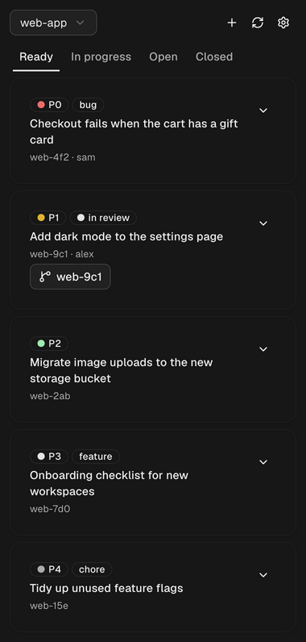

# orca-beads

An [Orca](https://github.com/stablyai/orca) plugin for [beads](https://github.com/steveyegge/beads) (`bd`) task tracking:

- **Sidebar panel**: the whole board, in Orca's right sidebar. It shows the project of the worktree you're focused on, and switches when you move. Ready, In progress, Open and Closed tabs; filter, expand details, claim, close, reopen and create tasks. In-progress tasks show the worktree working on them.
- **Start**: one click on a task claims it and creates an Orca worktree named after it, with an agent already working on it. The task's card then links to that worktree.
- **Commands**: `Beads: Show Panel` and `Beads: Show Ready Work` (a notification with your top ready tasks).

## Requirements

- Orca 1.4.247 or later, with **Plugin system** turned on in **Settings → Plugins** (it's experimental)
- `bd` on your machine (looked up on `PATH`, `~/.local/bin`, `/opt/homebrew/bin` and `/usr/local/bin`)
- macOS or Linux: Windows isn't supported yet

## Install

Open [Beads on the Orca plugin directory](https://www.onorca.dev/plugins/awallsr/orca-beads) and click **Open in Orca**, then **Install**.

Or by hand, either way:

- From the community catalog: in Orca, open **Settings → Plugins**, add the community catalog once with **Add marketplace** (URL `https://github.com/stablyai/orca-community-plugins.git`, ref `main`), search for **Beads** and choose **Install**.
- From this repository: in **Settings → Plugins**, choose **Add plugin → From a Git URL…**, paste `https://github.com/awallsr/orca-beads#v0.2.1` and choose **Install**. The `#v0.2.1` pins a release tag.

Orca asks you to approve what Beads can do: show notifications, read the focused worktree's name, branch and terminals (to show its project), and keep its own storage and settings. It runs `bd` and the `orca` CLI on your machine with your access, like any full-access plugin. Updates install by themselves, and Orca asks again only if one wants more access.

Then open the **Beads** panel in the right sidebar and focus a worktree of a beads project: the panel adds that project the first time. To add others, click ⚙ in the panel and paste the path of any folder inside a beads project. To get keyboard shortcuts, bind the two commands in Orca's keyboard shortcut settings, under Plugins.

### Develop

Clone the repo, then add the folder under **Development** in **Settings → Plugins** and click **Review & enable**. Orca reloads the panel and worker when you save a file. `orca plugin test .` runs `src/panel.test.tsx`, and `orca plugin check .` renders the panel in each scenario of `src/panel.check.ts`: `live` with the real worker, `sample` with made-up tasks. The screenshot above is `orca plugin shot . --scenario sample --theme dark --width 380 --out docs/panel.png`, with Orca's window minimized.

## How it works

- `src/panel.tsx` is a [components panel](https://github.com/stablyai/orca/blob/main/docs/reference/plugin-declarative-ui.md): sandboxed, so it asks the plugin's worker, `src/worker.ts`, to run `bd` and the `orca` CLI for it. `src/protocol.ts` types what they say to each other. Orca transpiles both on load; there's no build step, and saving a file reloads it.
- The panel follows the focused worktree: it shows the beads project containing it (git worktrees of a repo share its project), or a configured project inside it, for monorepos whose `.beads` lives in a subfolder. It refreshes every 15 seconds while visible, and right away after a change from any open panel.
- **Start** runs `orca worktree create` in the project's Orca repo (so the project must be added to Orca), named after the task id and with an agent prompted to `bd show` it. If the worktree can't be created, the claim is undone. A task is linked to any worktree of its repo whose name, branch or comment begins with the task id, so worktrees you make by hand link up too if you name them that way. The button with the worktree's name on a card switches Orca to it.
- Your project list is kept in the plugin's own Orca storage, outside this folder (a `config.json` from older versions is imported once). Which agent Start launches is the **Agent for Start** setting under Beads in Orca's Settings (default `claude`; any id `orca agent launch --agent` accepts).
